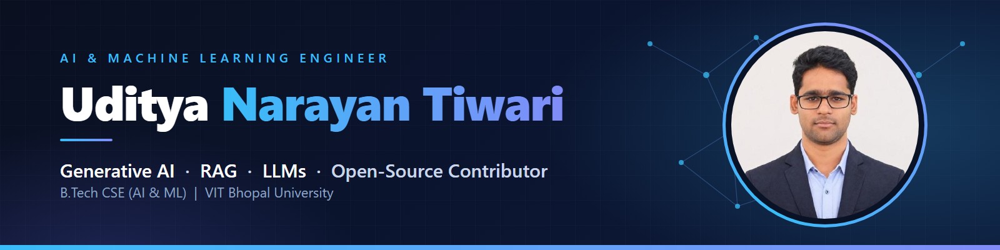

 

 

## About

I'm a B.Tech CSE (AI & ML) student at **VIT Bhopal University** building practical AI systems: retrieval-augmented generation, LLM applications and machine learning pipelines. I co-author two open-source projects, **RAGWire** and **SQL Notebook Studio**, and I'm a Technical Member & Community Admin of the Microsoft Learn Student Chapter.

- **Focus:** Generative AI, RAG, LLMs, NLP, Semantic Search, AI Agents
- **Problem solving:** 500+ LeetCode problems (Easy 336 · Medium 181 · Hard 11)
- **Open to:** internships and full-time roles in AI / ML engineering

## Featured Projects

| Project | What it does | Stack |
|---|---|---|
| [**NeuroLens**](https://github.com/udityamerit/NeuroLens-Knowledge-Retrieval-Engine) | Document RAG system with a FastAPI backend and React frontend for analysing documents and web content | FastAPI · React · Vector DB · LLMs |
| [**RAGWire**](https://github.com/udityamerit/RAGWire) *(co-author)* | Python toolkit for document ingestion, hybrid retrieval, reranking and cited answers | LangChain · Qdrant · Python |
| [**SQL Notebook Studio**](https://github.com/udityamerit/sql-notebook-studio) *(co-author)* | VS Code extension for Jupyter-style SQL notebooks with AI-assisted querying | TypeScript · VS Code API · LangChain |
| [**VisionGuard AI**](https://github.com/udityamerit/VisionGuard-AI-An-Intelligent-Surveillance-Platform) | Campus surveillance platform using computer vision and real-time video analytics | YOLOv8 · Python |
| [**Multimodel Analysis Package**](https://github.com/udityamerit/Multimodel-Analysis-Pacakge) | Auto-trains, evaluates and visualises multiple ML models for classification and regression | Scikit-learn · Pandas |
| [**Smart Medical Care**](https://github.com/udityamerit/Smart-Medical-Care-For-Rural-Areas) | NLP-based medicine recommendation system | Sentence-Transformers · NLP |

### Open-source co-authorship

**RAGWire** — Python toolkit for document ingestion, retrieval-augmented generation and grounded question answering, built around LangChain and Qdrant. Supports PDF, DOCX, XLSX, PPTX, Markdown and text files, hybrid dense/sparse search, cross-encoder reranking, cited answers, SHA256 deduplication and MCP integration.
[PyPI](https://pypi.org/project/ragwire/) · [Documentation](https://laxmimerit.github.io/RAGWire/) · [Upstream repository](https://github.com/laxmimerit/RAGWire)

**SQL Notebook Studio** — VS Code extension for Jupyter-style SQL notebooks covering MySQL/MariaDB, PostgreSQL, SQL Server, SQLite and DuckDB, with interactive result grids, one-click charts, schema-aware autocomplete, SSH tunnels and AI-assisted SQL generation, debugging and optimisation (including local models via Ollama).
[VS Code Marketplace](https://marketplace.visualstudio.com/items?itemName=kgptalkie.sql-notebook-studio) · [Upstream repository](https://github.com/laxmimerit/sql-notebook-studio)

## Tech Stack

**Languages** &nbsp;      

**ML / Deep Learning** &nbsp;       

**GenAI & RAG** &nbsp;     

**Backend & Tools** &nbsp;     

## GitHub Stats

## Community

- Technical Member & Community Admin — Microsoft Learn Student Chapter
- Former Core Team Member — Matrix Media Club
